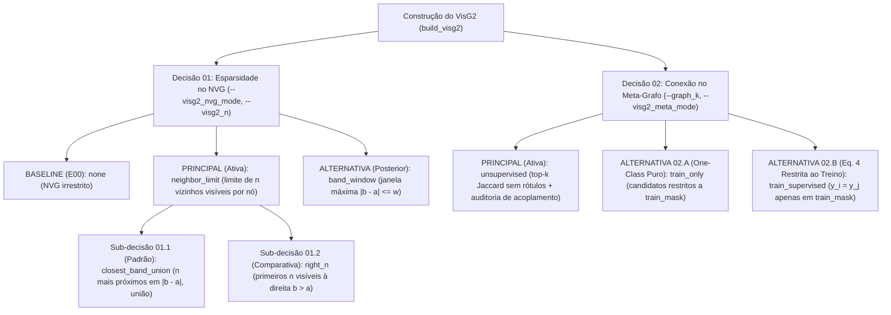

# Auditoria Técnica e Árvore de Decisões — Construção do VisG2 (ATR-FTIR + OLGA)

> **Projeto:** Iniciação Científica (UFU — Grupo AI Net) — Detecção não invasiva de diabetes via espectros ATR-FTIR com grafos e OLGA (*One-Class Graph Autoencoder*).  
> **Referência teórica base:** Lima Filho, Sabino-Silva & Carneiro (IJCNN 2025), *"High-level classification based on meta-graph of visibility graphs for Autism detection"*.  
> **Status desta etapa:** Plano estrutural validado e implementado localmente em `graph_builders.py` e `main.py`, pronto para sincronização e execução controlada no `docker-lab` remoto.

---

## 1. Escopo Estrito e Regras de Controle Experimental

- **Escopo ativo:** Auditar e evoluir **exclusivamente** a construção do meta-grafo **VisG2** (`build_visg2` em `OLGA/codes/olga/graph_builders.py`) e a passagem limpa de parâmetros via CLI no `OLGA/codes/olga/main.py`, mantendo os construtores de grafo desacoplados do modelo OLGA.
- **Fora de escopo (inalterado nesta etapa):**
  - Arquitetura, função de perda, mascaramento e rotina de treino/avaliação do modelo **OLGA** (`olga.py`, `oneclass.py`, `train_olga`, `train_parameters`).
  - Demais construtores de grafo (`build_knn`, `build_sknn`, `build_mknn`, `build_smknn`, `build_cosine_knn`, `build_pearson_network`, `build_dtw_knn`).
  - Fusão com metadados clínicos (`GENDER`, `AGE`, `HEMOGLOBIN`, `GLUCOSE`) e pipeline `ftir-prep` em `data_loader.py`.
- **Princípio de rastreabilidade:** Toda decisão que altera a topologia do NVG ou do meta-grafo está registrada abaixo como **Escolha Principal (ativa)** ou **Alternativa em Segundo Plano (comparativa)** e mapeada diretamente para uma flag CLI sem necessidade de editar código entre baterias de testes.

---

## 2. Diagnóstico da Auditoria do Código Base (Baseline `E00`)

### 2.1 Dados e Pré-processamento (`OLGA/codes/olga/data_loader.py`)
- **Entrada (`dataset/train/train.csv` e `dataset/test/test.csv`):**
  - `train.csv`: **520 amostras** rotuladas (`class == 0`: 250; `class == 1`: 270), com 6 colunas de metadados (`id`, `GENDER`, `AGE`, `HEMOGLOBIN`, `GLUCOSE`, `class`) e **3.736 bandas espectrais** estritamente crescentes de `399.1927` a `4000.605` $\text{cm}^{-1}$, com passo quase uniforme ($\Delta\tilde{\nu} \in [0.9639,\; 0.9650]\;\text{cm}^{-1}$).
  - `test.csv`: **312 amostras** sem a coluna `class` (removidas por `dropna(subset=["class"])`), restando as **520 amostras rotuladas**.
- **Pré-processamento (`ftir-prep==0.3.5`):**
  - Truncamento na região `'fingerprint'` ($\approx 933$ bandas em $900\text{–}1800\;\text{cm}^{-1}$), baseline `'rubberband'`, Savitzky-Golay (`polyorder=2`) e normalização `'minmax'`.
- **Implicação para o NVG:** Como o espaçamento espectral é praticamente constante ($\approx 0{,}964\;\text{cm}^{-1}$ por ponto) e a condição de visibilidade (Eq. 1) é invariante a transformações afins no eixo horizontal, a distância em índices $|b - a|$ traduz-se diretamente em distância espectral física ($\Delta\tilde{\nu} \approx 0{,}964 \cdot |b - a|\;\text{cm}^{-1}$).

### 2.2 Diagnóstico do `build_visg2` Original (`OLGA/codes/olga/graph_builders.py`)
- **Dependência:** `ts2vg==1.2.4` (`requirements.txt` na raiz do repositório).
- **NVG por espectro:** Chamava `NaturalVG().build(X_total[i])` sem corte de vizinhança/alcance ($n$). Em espectros de $\sim 933$ pontos, picos dominantes atuam como *hubs* globais conectando centenas de bandas distantes e dominando o coeficiente de Jaccard.
  - *Nota sobre `ts2vg==1.2.4`:* `NaturalVG` não possui parâmetro nativo de limite de $n$ conexões por nó (`penetrable_limit` faz o inverso, aumentando a densidade; `weighted="abs_h_distance"` com `max_weight` usa desigualdade estrita `< max_weight` e muda `vg.edges` para triplas `(u, v, w)`). Por isso, a poda determinística pós-`NaturalVG` sobre pares canônicos `(min(u, v), max(u, v))` é a solução mais limpa, exata e auditável.
- **Matriz de Jaccard:** Fiel às Eqs. 2–3 ($|E_i \cap E_j| / |E_i \cup E_j|$). Otimizada via matriz de incidência esparsa CSR em *streaming* (`scipy.sparse`, interseções via $B B^\top$ e união via $|E_i| + |E_j| - |E_i \cap E_j|$), mantendo resultado **bit-a-bit idêntico** ao laço de conjuntos com redução drástica de tempo e consumo de RAM nos 520 espectros.
- **Meta-grafo:** Top-$k$ não-supervisionado simetrizado com `np.maximum(A, A.T)`. Adicionadas validação `1 <= k < n_samples` e ordenação estável (`kind="stable"`) para determinismo em empates de Jaccard.

### 2.3 Diagnóstico de Orquestração (`OLGA/codes/olga/main.py`, `utils.py` e `job.env`)
- **Gravação de resultados (`utils.py` + `main.py`):** Com o ajuste de `write_results` em `OLGA/codes/olga/utils.py` (commit `ab0695d`), a saída é gravada em `OLGA/codes/results/<file_name>`. Para evitar que experimentos diferentes sobrescrevam ou misturem linhas indistinguíveis num único `OLGA.csv`, `main.py` agora compõe `file_name = f"{args.dataset}_{args.k}_OLGA.csv"` (onde `--k` recebe `EXP_TAG`).
- **Resolução robusta de `dataset/` e leitura de `job.env`:** `main.py` resolve automaticamente `dataset/train/train.csv` e `dataset/test/test.csv` tanto a partir da raiz do repositório (`REPO_ROOT`, padrão do `docker_lab/run.sh`) quanto de `OLGA/codes/olga/`, e carrega os parâmetros `DATASET`, `EXP_TAG`, `GRAPH_MODEL`, `GRAPH_K` e `VISG2_*` diretamente do `job.env` (mantendo precedência total para flags CLI quando invocadas diretamente).
- **Observabilidade no `docker-lab` (`main.py`):** Ativação de `line_buffering=True` em `stdout`/`stderr`, telemetria de tempo decorrido e uso de RAM (`psutil`, `_log_stage`) por etapa e captura explícita de *traceback* em `stdout` em caso de exceção não tratada, evitando logs vazios (0 bytes).
- **Ordem entre máscaras de split e construção do grafo:** A geração de `train_mask`, `val_mask` e `test_mask` foi posicionada imediatamente antes do roteador de grafos, preservando exatamente o mesmo estado do gerador pseudoaleatório (`np.random.seed(42)`) do baseline `E00`. Isso permite:
  1. Auditar em modo somente-leitura o acoplamento estrutural entre `train`, `val` e `test` na Escolha Principal;
  2. Habilitar de forma limpa e sem *data leakage* as variantes restritas a `train_mask` na Decisão 02.
- **Baseline externo registrado (`ab0695d`):** `OLGA/codes/olga/run_cnn.py` adiciona um baseline supervisionado 1D-CNN (divisão 80%/20%), independente do fluxo one-class do OLGA/VisG2.
- **Observação lateral registrada (fora do escopo — código do OLGA intocado):** em `main.py`, `train_mask` usa `classe_controle = 0` (`label = 0`), enquanto `oneclass.py` (linhas 52–55) trata `label == 1` como `interest` e `label == 0` como `outlier`. Mantido inalterado conforme restrição estrita de escopo para verificação futura dedicada.

---

## 3. Árvore de Decisões do VisG2



---

### Decisão 01 — Restrição de Vizinhança / Esparsidade no Grafo de Visibilidade (parâmetro $n$)

- **Motivação:** Controlar a densidade dos NVGs individuais para impedir que poucos picos globais dominem o conjunto de arestas $E_i$ e mascararem variações locais da assinatura bioquímica no coeficiente de Jaccard (alinhado ao uso de $n$ baixo no artigo IJCNN 2025).
- **Flags CLI correspondentes:** `--visg2_nvg_mode {none,neighbor_limit,band_window}` e `--visg2_n <int>`.

#### Escolha Principal (Ativa para Experimentação) — `nvg_mode="neighbor_limit"`
Limita o número de conexões visíveis mantidas por nó no NVG a partir de duas políticas determinísticas configuráveis via `--visg2_neighbor_policy`:

1. **Sub-decisão 01.1 (Padrão Inicial Validado) — `neighbor_policy="closest_band_union"`:**
   - Para cada nó $a \in \{0, \dots, L-1\}$, ordenam-se todos os seus vizinhos visíveis $b \in N_{\text{NVG}}(a)$ pela menor distância espectral $|b - a|$ (desempate determinístico pelo menor índice $b$) e selecionam-se os $n$ primeiros.
   - A aresta não-direcionada $(u, v)$ é mantida pela **união** das seleções ($v \in \text{top-}n(u) \lor u \in \text{top-}n(v)$), preservando simetria bilateral no espectro (bandas à esquerda e à direita de um pico/vale local).
   - **Propriedade matemática importante (limiar mínimo de $n$):** Em qualquer NVG 1D, pontos adjacentes $(a, a+1)$ são sempre visíveis entre si ($|b - a| = 1$). Logo, todo ponto interno $1 \le a \le L-2$ já consome **2 vagas** em vizinhos triviais imediatos $(a-1)$ e $(a+1)$ (comuns a 100% dos espectros). Assim, em `closest_band_union`, atalhos de visibilidade não-triviais ($|b - a| \ge 2$, que carregam a informação discriminativa real) passam a existir nos nós internos a partir de **$n \ge 3$** (cada nó interno retém até $n - 2$ atalhos não-triviais).
2. **Sub-decisão 01.2 (Alternativa de Política para Comparação) — `neighbor_policy="right_n"`:**
   - Seguindo a orientação sequencial $a < b$ da Eq. 1, cada ponto $a$ mantém apenas os seus primeiros $n$ vizinhos visíveis à direita ($b > a$, menores valores de $b - a$).
   - Como há apenas **1** vizinho trivial imediato à direita ($b = a + 1$), atalhos de visibilidade não-triviais já surgem a partir de **$n \ge 2$** (cada ponto $a$ retém até $n - 1$ atalhos à direita), com teto estrito $|E_i| \le n \cdot (L - 1)$.
   - *Equivalência de orçamento de atalhos por nó:* comparar `closest_band_union` com $n = m + 2$ frente a `right_n` com $n = m + 1$ ($m \ge 1$).

#### Alternativa em Segundo Plano (Para Teste Posterior) — `nvg_mode="band_window"`
- Mantém no NVG apenas arestas visíveis cuja distância em índices satisfaça $|b - a| \le w$ (horizonte espectral fixo $\Delta\tilde{\nu} \approx 0{,}964 \cdot w\;\text{cm}^{-1}$), avaliando proximidade morfológica estrita entre bandas adjacentes.

---

### Decisão 02 — Critério de Conexão no Meta-Grafo (Não-Supervisionado vs. Restrito ao Treino)

- **Motivação:** Conciliar a formulação do meta-grafo do VisG2 (Eq. 4 do artigo IJCNN 2025) com o aprendizado **one-class** transdutivo do OLGA sem introduzir *label leakage*.
- **Flags CLI correspondentes:** `--graph_k <int>` e `--visg2_meta_mode {unsupervised,train_only,train_supervised}`.

#### Escolha Principal (Ativa Agora) — `meta_mode="unsupervised"`
- Conecta cada super-nó aos seus $k$ vizinhos de maior similaridade de Jaccard em `X_total` (excluindo auto-laços), simetrizado via `np.maximum(A, A.T)`, **sem acessar `y_total`**.
- **Monitoramento automático em cada execução:** `compute_visg2_diagnostics` imprime no console:
  - Densidade dos NVGs (média, desvio, mín, máx de arestas por espectro);
  - Estatísticas da matriz de Jaccard (média, desvio, mediana, máx, % de pares com Jaccard zero);
  - Topologia do meta-grafo (arestas totais, grau médio/mín/máx, nº de componentes conexas);
  - **Acoplamento entre partições:** % de arestas `train–train`, `train–val`, `train–test` e `val/test–val/test`;
  - **Homofilia diagnóstica (somente leitura pós-construção):** % de arestas onde $y_i = y_j$, permitindo verificar se o ajuste de $n$ reduz conexões espúrias entre controles e diabéticos antes mesmo do treino da GNN.

#### Alternativas em Segundo Plano (Para Teste Posterior Sem Vazamento de Rótulos)
1. **`meta_mode="train_only"` (Controle de acoplamento transdutivo no regime one-class):**
   - Restringe os candidatos top-$k$ apenas aos nós pertencentes a `train_mask` (sem usar rótulos de `val`/`test`). Após simetrização `np.maximum(A, A.T)`, nós de `train` conectam-se entre si sem interferência de `val`/`test`, e nós de `val`/`test` ancoram-se aos seus $k$ controles de treino mais similares.
2. **`meta_mode="train_supervised"` (Eq. 4 restrita estritamente ao conjunto de treino):**
   - Para nós em `train_mask`, exige $y_i = y_j$ entre candidatos de `train_mask` (os rótulos fora de `train_mask` nunca são lidos). Nós fora de `train_mask` conectam-se aos seus top-$k$ em `train_mask` sem consulta de rótulo.
   - *Nota matemática:* Como o `train_mask` atual do OLGA contém apenas uma classe (`classe_controle`), $y_i = y_j$ já vale para todo par em `train_mask` (tornando `train_supervised` estruturalmente equivalente a `train_only` no one-class puro, mas já pronto caso um protocolo futuro tenha múltiplas classes rotuladas no treino).

---

## 4. Guia Rápido de Execução na `ainetmachine` (`job.env` + `docker-lab`)

Na `ainetmachine`, dentro de `~/ATR-FTIR-integred-to-OLGA`, dispare o job e acompanhe pelo subcomando de logs do `docker-lab`:

```bash
docker-lab run
docker-lab logs renan_visg2_E00
```

*(Dica: ao mudar de etapa no `job.env`, atualize também `JOB_NAME={USERNAME}_visg2_<etapa>` se quiser manter um arquivo de log separado em `/opt/docker_lab/logs/` para cada bateria.)*

Cada experimento gera seu próprio arquivo isolado em `OLGA/codes/results/<DATASET>_<EXP_TAG>_OLGA.csv` e imprime no log o bloco `[VisG2 Diagnóstico Estrutural]`.

### Valores no `job.env` por Etapa Experimental (alterar apenas as variáveis abaixo)

| Etapa | `EXP_TAG` | `GRAPH_K` | `VISG2_NVG_MODE` | `VISG2_N` | `VISG2_NEIGHBOR_POLICY` | `VISG2_META_MODE` |
| :--- | :--- | :---: | :--- | :---: | :--- | :--- |
| **E00 (Baseline atual)** | `visg2_E00_base` | `3` | `none` | `none` | `closest_band_union` | `unsupervised` |
| **E01 (Principal — união)** | `visg2_E01_union_n3` *(varie 3, 4, 6, 8, 10)* | `3` | `neighbor_limit` | `3, 4, 6, 8, 10` | `closest_band_union` | `unsupervised` |
| **E01R (Sub-decisão `right_n`)** | `visg2_E01R_right_n2` *(varie 2, 3, 5)* | `3` | `neighbor_limit` | `2, 3, 5` | `right_n` | `unsupervised` |
| **E02 (Sensibilidade a `k`)** | `visg2_E02_k5` *(varie 5, 7)* | `5, 7` | `neighbor_limit` | *melhor `n`* | *melhor política* | `unsupervised` |
| **E03 (Alt. D01 — janela)** | `visg2_E03_win10` *(varie 10, 25)* | *melhor `k`* | `band_window` | `10, 25` | `closest_band_union` | `unsupervised` |
| **E04 (Alt. D02 — treino)** | `visg2_E04_trainsup` | *melhor `k`* | *melhor modo* | *melhor `n`* | *melhor política* | `train_supervised` |

### Alternativa via CLI direta (em shell interativo com `.venv` — flags CLI prevalecem sobre `job.env`)

```bash
.venv/bin/python OLGA/codes/olga/main.py \
  --graph_model visg2 \
  --visg2_nvg_mode neighbor_limit \
  --visg2_n 4 \
  --visg2_neighbor_policy closest_band_union \
  --k visg2_E01_union_n4
```

---

## 5. Registro de Resultados Experimentais (`docker-lab`)

| ID Exp. | `nvg_mode` / `policy` | `n` / `w` | `k` | `meta_mode` | Arestas médias/NVG | Jaccard médio ± dp | Grau médio meta | Comp. conexas | Homofilia (%) | % `train`–não-treino | Macro-F1 (Val) | Tempo (s) |
| :--- | :--- | :---: | :---: | :--- | :---: | :---: | :---: | :---: | :---: | :---: | :---: | :---: |
| **E00** | `none` / `-` | `None` | `3` | `unsupervised` | _pendente_ | _pendente_ | _pendente_ | _pendente_ | _pendente_ | _pendente_ | _pendente_ | _pendente_ |
