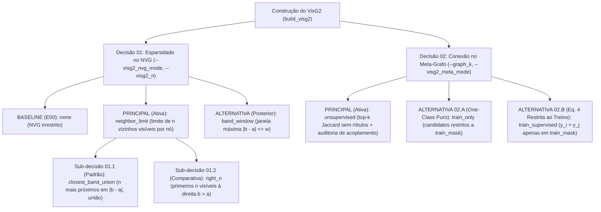

# Auditoria Técnica e Árvore de Decisões — Construção do VisG2 (ATR-FTIR + OLGA)

> **Projeto:** Iniciação Científica (UFU — Grupo AI Net) — Detecção não invasiva de diabetes via espectros ATR-FTIR com grafos e OLGA (*One-Class Graph Autoencoder*).  
> **Referência teórica base:** Lima Filho, Sabino-Silva & Carneiro (IJCNN 2025), *"High-level classification based on meta-graph of visibility graphs for Autism detection"*.  
> **Status desta etapa:** Concluída — todas as **20** execuções controladas (`E00` a `E05_fine`) foram auditadas e consolidadas na `ainetmachine` (`docker-lab`), definindo a configuração campeã do VisG2.

---

## 1. Escopo Estrito e Regras de Controle Experimental

- **Escopo ativo:** Auditar e evoluir **exclusivamente** a construção do meta-grafo **VisG2** (`build_visg2` em `OLGA/codes/olga/graph_builders.py`) e a passagem limpa de parâmetros via CLI no `OLGA/codes/olga/main.py`, mantendo os construtores de grafo desacoplados do modelo OLGA.
- **Fora de escopo (inalterado nesta etapa):**
  - Arquitetura, função de perda, mascaramento e rotina de treino/avaliação do modelo **OLGA** (`olga.py`, `oneclass.py`, `train_olga`, `train_parameters`).
  - Demais construtores de grafo (`build_knn`, `build_sknn`, `build_mknn`, `build_smknn`, `build_cosine_knn`, `build_pearson_network`, `build_dtw_knn`).
  - Fusão com metadados clínicos (`GENDER`, `AGE`, `HEMOGLOBIN`, `GLUCOSE`) e pipeline `ftir-prep` em `data_loader.py`.
- **Princípio de rastreabilidade:** Toda decisão que altera a topologia do NVG ou do meta-grafo está registrada abaixo como **Escolha Principal (ativa)** ou **Alternativa em Segundo Plano (comparativa)** e mapeada diretamente para uma flag CLI sem necessidade de editar código entre baterias de testes.

---

## 2. Diagnóstico da Auditoria do Código Base (Baseline `E00`)

### 2.1 Dados e Pré-processamento (`OLGA/codes/olga/data_loader.py`)
- **Entrada (`dataset/train/train.csv` e `dataset/test/test.csv`):**
  - `train.csv`: **520 amostras** rotuladas (`class == 0`: 250; `class == 1`: 270), com 6 colunas de metadados (`id`, `GENDER`, `AGE`, `HEMOGLOBIN`, `GLUCOSE`, `class`) e **3.736 bandas espectrais** estritamente crescentes de `399.1927` a `4000.605` $\text{cm}^{-1}$, com passo quase uniforme ($\Delta\tilde{\nu} \in [0.9639,\; 0.9650]\;\text{cm}^{-1}$).
  - `test.csv`: **312 amostras** sem a coluna `class` (removidas por `dropna(subset=["class"])`), restando as **520 amostras rotuladas**.
- **Pré-processamento (`ftir-prep==0.3.5`):**
  - Truncamento na região `'fingerprint'` ($\approx 933$ bandas em $900\text{–}1800\;\text{cm}^{-1}$), baseline `'rubberband'`, Savitzky-Golay (`polyorder=2`) e normalização `'minmax'`.
- **Implicação para o NVG:** Como o espaçamento espectral é praticamente constante ($\approx 0{,}964\;\text{cm}^{-1}$ por ponto) e a condição de visibilidade (Eq. 1) é invariante a transformações afins no eixo horizontal, a distância em índices $|b - a|$ traduz-se diretamente em distância espectral física ($\Delta\tilde{\nu} \approx 0{,}964 \cdot |b - a|\;\text{cm}^{-1}$).

### 2.2 Diagnóstico do `build_visg2` Original (`OLGA/codes/olga/graph_builders.py`)
- **Dependência:** `ts2vg==1.2.4` (`requirements.txt` na raiz do repositório).
- **NVG por espectro:** Chamava `NaturalVG().build(X_total[i])` sem corte de vizinhança/alcance ($n$). Em espectros de $\sim 933$ pontos, picos dominantes atuam como *hubs* globais conectando centenas de bandas distantes e dominando o coeficiente de Jaccard.
  - *Nota sobre `ts2vg==1.2.4`:* `NaturalVG` não possui parâmetro nativo de limite de $n$ conexões por nó (`penetrable_limit` faz o inverso, aumentando a densidade; `weighted="abs_h_distance"` com `max_weight` usa desigualdade estrita `< max_weight` e muda `vg.edges` para triplas `(u, v, w)`). Por isso, a poda determinística pós-`NaturalVG` sobre pares canônicos `(min(u, v), max(u, v))` é a solução mais limpa, exata e auditável.
- **Matriz de Jaccard:** Fiel às Eqs. 2–3 ($|E_i \cap E_j| / |E_i \cup E_j|$). Otimizada via matriz de incidência esparsa CSR em *streaming* (`scipy.sparse`, interseções via $B B^\top$ e união via $|E_i| + |E_j| - |E_i \cap E_j|$), mantendo resultado **bit-a-bit idêntico** ao laço de conjuntos com redução drástica de tempo e consumo de RAM nos 520 espectros.
- **Meta-grafo:** Top-$k$ não-supervisionado simetrizado com `np.maximum(A, A.T)`. Adicionadas validação `1 <= k < n_samples` e ordenação estável (`kind="stable"`) para determinismo em empates de Jaccard.

### 2.3 Diagnóstico de Orquestração (`OLGA/codes/olga/main.py`, `utils.py` e `job.env`)
- **Gravação de resultados (`utils.py` + `main.py`):** Com o ajuste de `write_results` em `OLGA/codes/olga/utils.py` (commit `ab0695d`), a saída é gravada em `OLGA/codes/results/<file_name>`. Para evitar que experimentos diferentes sobrescrevam ou misturem linhas indistinguíveis num único `OLGA.csv`, `main.py` agora compõe `file_name = f"{args.dataset}_{args.k}_OLGA.csv"` (onde `--k` recebe `EXP_TAG`).
- **Resolução robusta de `dataset/` e leitura de `job.env`:** `main.py` resolve automaticamente `dataset/train/train.csv` e `dataset/test/test.csv` tanto a partir da raiz do repositório (`REPO_ROOT`, padrão do `docker_lab/run.sh`) quanto de `OLGA/codes/olga/`, e carrega os parâmetros `DATASET`, `EXP_TAG`, `GRAPH_MODEL`, `GRAPH_K` e `VISG2_*` diretamente do `job.env` (mantendo precedência total para flags CLI quando invocadas diretamente).
- **Observabilidade no `docker-lab` (`main.py`):** Ativação de `line_buffering=True` em `stdout`/`stderr`, telemetria de tempo decorrido e uso de RAM (`psutil`, `_log_stage`) por etapa e captura explícita de *traceback* em `stdout` em caso de exceção não tratada, evitando logs vazios (0 bytes).
- **Ordem entre máscaras de split e construção do grafo:** A geração de `train_mask`, `val_mask` e `test_mask` foi posicionada imediatamente antes do roteador de grafos, preservando exatamente o mesmo estado do gerador pseudoaleatório (`np.random.seed(42)`) do baseline `E00`. Isso permite:
  1. Auditar em modo somente-leitura o acoplamento estrutural entre `train`, `val` e `test` na Escolha Principal;
  2. Habilitar de forma limpa e sem *data leakage* as variantes restritas a `train_mask` na Decisão 02.
- **Baseline externo registrado (`ab0695d`):** `OLGA/codes/olga/run_cnn.py` adiciona um baseline supervisionado 1D-CNN (divisão 80%/20%), independente do fluxo one-class do OLGA/VisG2.
- **Observação lateral registrada (fora do escopo — código do OLGA intocado):** em `main.py`, `train_mask` usa `classe_controle = 0` (`label = 0`), enquanto `oneclass.py` (linhas 52–55) trata `label == 1` como `interest` e `label == 0` como `outlier`. Mantido inalterado conforme restrição estrita de escopo para verificação futura dedicada.

---

## 3. Árvore de Decisões do VisG2



---

### Decisão 01 — Restrição de Vizinhança / Esparsidade no Grafo de Visibilidade (parâmetro $n$)

- **Motivação:** Controlar a densidade dos NVGs individuais para impedir que poucos picos globais dominem o conjunto de arestas $E_i$ e mascararem variações locais da assinatura bioquímica no coeficiente de Jaccard (alinhado ao uso de $n$ baixo no artigo IJCNN 2025).
- **Flags CLI correspondentes:** `--visg2_nvg_mode {none,neighbor_limit,band_window}` e `--visg2_n <int>`.

#### Escolha Principal (Ativa para Experimentação) — `nvg_mode="neighbor_limit"`
Limita o número de conexões visíveis mantidas por nó no NVG a partir de duas políticas determinísticas configuráveis via `--visg2_neighbor_policy`:

1. **Sub-decisão 01.1 (Padrão Inicial Validado) — `neighbor_policy="closest_band_union"`:**
   - Para cada nó $a \in \{0, \dots, L-1\}$, ordenam-se todos os seus vizinhos visíveis $b \in N_{\text{NVG}}(a)$ pela menor distância espectral $|b - a|$ (desempate determinístico pelo menor índice $b$) e selecionam-se os $n$ primeiros.
   - A aresta não-direcionada $(u, v)$ é mantida pela **união** das seleções ($v \in \text{top-}n(u) \lor u \in \text{top-}n(v)$), preservando simetria bilateral no espectro (bandas à esquerda e à direita de um pico/vale local).
   - **Propriedade matemática importante (limiar mínimo de $n$):** Em qualquer NVG 1D, pontos adjacentes $(a, a+1)$ são sempre visíveis entre si ($|b - a| = 1$). Logo, todo ponto interno $1 \le a \le L-2$ já consome **2 vagas** em vizinhos triviais imediatos $(a-1)$ e $(a+1)$ (comuns a 100% dos espectros). Assim, em `closest_band_union`, atalhos de visibilidade não-triviais ($|b - a| \ge 2$, que carregam a informação discriminativa real) passam a existir nos nós internos a partir de **$n \ge 3$** (cada nó interno retém até $n - 2$ atalhos não-triviais).
2. **Sub-decisão 01.2 (Alternativa de Política para Comparação) — `neighbor_policy="right_n"`:**
   - Seguindo a orientação sequencial $a < b$ da Eq. 1, cada ponto $a$ mantém apenas os seus primeiros $n$ vizinhos visíveis à direita ($b > a$, menores valores de $b - a$).
   - Como há apenas **1** vizinho trivial imediato à direita ($b = a + 1$), atalhos de visibilidade não-triviais já surgem a partir de **$n \ge 2$** (cada ponto $a$ retém até $n - 1$ atalhos à direita), com teto estrito $|E_i| \le n \cdot (L - 1)$.
   - *Equivalência de orçamento de atalhos por nó:* comparar `closest_band_union` com $n = m + 2$ frente a `right_n` com $n = m + 1$ ($m \ge 1$).

#### Alternativa em Segundo Plano (Para Teste Posterior) — `nvg_mode="band_window"`
- Mantém no NVG apenas arestas visíveis cuja distância em índices satisfaça $|b - a| \le w$ (horizonte espectral fixo $\Delta\tilde{\nu} \approx 0{,}964 \cdot w\;\text{cm}^{-1}$), avaliando proximidade morfológica estrita entre bandas adjacentes.

---

### Decisão 02 — Critério de Conexão no Meta-Grafo (Não-Supervisionado vs. Restrito ao Treino)

- **Motivação:** Conciliar a formulação do meta-grafo do VisG2 (Eq. 4 do artigo IJCNN 2025) com o aprendizado **one-class** transdutivo do OLGA sem introduzir *label leakage*.
- **Flags CLI correspondentes:** `--graph_k <int>` e `--visg2_meta_mode {unsupervised,train_only,train_supervised}`.

#### Escolha Principal (Ativa Agora) — `meta_mode="unsupervised"`
- Conecta cada super-nó aos seus $k$ vizinhos de maior similaridade de Jaccard em `X_total` (excluindo auto-laços), simetrizado via `np.maximum(A, A.T)`, **sem acessar `y_total`**.
- **Monitoramento automático em cada execução:** `compute_visg2_diagnostics` imprime no console:
  - Densidade dos NVGs (média, desvio, mín, máx de arestas por espectro);
  - Estatísticas da matriz de Jaccard (média, desvio, mediana, máx, % de pares com Jaccard zero);
  - Topologia do meta-grafo (arestas totais, grau médio/mín/máx, nº de componentes conexas);
  - **Acoplamento entre partições:** % de arestas `train–train`, `train–val`, `train–test` e `val/test–val/test`;
  - **Homofilia diagnóstica (somente leitura pós-construção):** % de arestas onde $y_i = y_j$, permitindo verificar se o ajuste de $n$ reduz conexões espúrias entre controles e diabéticos antes mesmo do treino da GNN.

#### Alternativas em Segundo Plano (Para Teste Posterior Sem Vazamento de Rótulos)
1. **`meta_mode="train_only"` (Controle de acoplamento transdutivo no regime one-class):**
   - Restringe a seleção top-$k$ originada por nós de treino ($i \in \text{train\_mask}$) apenas a candidatos também em `train_mask` (sem usar rótulos de `val`/`test`), blindando o núcleo de treino contra anomalias. Nós fora de `train_mask` (`val`/`test`) continuam selecionando seus top-$k$ de forma não-supervisionada no grafo completo — garantindo tanto ausência de *label leakage* quanto a presença de arestas internas no subgrafo `g_unsup` exigido pelo `recon_loss_unsup` do OLGA.
2. **`meta_mode="train_supervised"` (Eq. 4 restrita estritamente ao conjunto de treino):**
   - Para nós em `train_mask`, exige $y_i = y_j$ entre candidatos de `train_mask` (os rótulos fora de `train_mask` nunca são lidos). Nós fora de `train_mask` continuam selecionando seus top-$k$ de forma não-supervisionada no grafo completo, preservando o subgrafo `g_unsup` e zero *label leakage*.
   - *Nota matemática:* Como o `train_mask` atual do OLGA contém apenas uma classe (`classe_controle`), $y_i = y_j$ já vale para todo par em `train_mask` (tornando `train_supervised` estruturalmente equivalente a `train_only` no one-class puro, mas já pronto caso um protocolo futuro tenha múltiplas classes rotuladas no treino).

---

## 4. Guia Rápido de Execução na `ainetmachine` (`job.env` + `docker-lab`)

Na `ainetmachine`, dentro de `~/ATR-FTIR-integred-to-OLGA`, dispare o job e acompanhe pelo subcomando de logs do `docker-lab`:

```bash
docker-lab run
docker-lab logs renan_visg2_E00
```

> **Execução em baterias controladas (`--battery {E01_E01R, E02_E04, E05_fine}`):** O orquestrador `OLGA/codes/olga/run_visg2_sweep.py` executa cada configuração em processo isolado do `main.py` (~1–3 min por bateria). Atualmente está ativo com `--battery E05_fine` como padrão (`JOB_NAME={USERNAME}_visg2_E05_fine` no `job.env`; acompanhar via `docker-lab logs renan_visg2_E05_fine`), avaliando os 3 vizinhos inteiros em torno de `(n=8, k=3)`: `(7, 3)`, `(9, 3)` e `(8, 4)`. Para reexecutar as baterias anteriores, passe `--battery E01_E01R` ou `--battery E02_E04`.

*(Dica: ao mudar de etapa no `job.env`, atualize também `JOB_NAME={USERNAME}_visg2_<etapa>` se quiser manter um arquivo de log separado em `/opt/docker_lab/logs/` para cada bateria.)*

Cada experimento gera seu próprio arquivo isolado em `OLGA/codes/results/<DATASET>_<EXP_TAG>_OLGA.csv` e imprime no log o bloco `[VisG2 Diagnóstico Estrutural]`.

### Valores no `job.env` por Etapa Experimental (alterar apenas as variáveis abaixo)

| Etapa | `EXP_TAG` | `GRAPH_K` | `VISG2_NVG_MODE` | `VISG2_N` | `VISG2_NEIGHBOR_POLICY` | `VISG2_META_MODE` |
| :--- | :--- | :---: | :--- | :---: | :--- | :--- |
| **E00 (Baseline atual)** | `visg2_E00_base` | `3` | `none` | `none` | `closest_band_union` | `unsupervised` |
| **E01 (Principal — união)** | `visg2_E01_union_n3` *(varie 3, 4, 6, 8, 10)* | `3` | `neighbor_limit` | `3, 4, 6, 8, 10` | `closest_band_union` | `unsupervised` |
| **E01R (Sub-decisão `right_n`)** | `visg2_E01R_right_n2` *(varie 2, 3, 5)* | `3` | `neighbor_limit` | `2, 3, 5` | `right_n` | `unsupervised` |
| **E02 (Sensibilidade a `k`)** | `visg2_E02_k5` *(varie 5, 7)* | `5, 7` | `neighbor_limit` | *melhor `n`* | *melhor política* | `unsupervised` |
| **E03 (Alt. D01 — janela)** | `visg2_E03_win10` *(varie 10, 25)* | *melhor `k`* | `band_window` | `10, 25` | `closest_band_union` | `unsupervised` |
| **E04 (Alt. D02 — treino)** | `visg2_E04_trainsup` | *melhor `k`* | *melhor modo* | *melhor `n`* | *melhor política* | `train_supervised` |
| **E05 (Refinamento fino)** | `visg2_E05_union_n7_k3` *(7/3, 9/3, 8/4)* | `3, 4` | `neighbor_limit` | `7, 8, 9` | `closest_band_union` | `unsupervised` |

### Alternativa via CLI direta (em shell interativo com `.venv` — flags CLI prevalecem sobre `job.env`)

```bash
.venv/bin/python OLGA/codes/olga/main.py \
  --graph_model visg2 \
  --visg2_nvg_mode neighbor_limit \
  --visg2_n 4 \
  --visg2_neighbor_policy closest_band_union \
  --k visg2_E01_union_n4
```

---

## 5. Registro de Resultados Experimentais (`docker-lab`)

| ID Exp. | `nvg_mode` / `policy` | `n` / `w` | `k` | `meta_mode` | Arestas médias/NVG | Jaccard médio ± dp | Grau médio meta | Comp. conexas | Homofilia (%) | % `train`–não-treino | Macro-F1 (Val) | Tempo (s) |
| :--- | :--- | :---: | :---: | :--- | :---: | :---: | :---: | :---: | :---: | :---: | :---: | :---: |
| **E00** | `none` / `-` | `None` | `3` | `unsupervised` | `17413.8 ± 2144.3` | `0.4542 ± 0.1011` | `4.67` | `6` | `77.16%` | `28.4%` (`14.9%` val / `13.5%` test) | `0.4768` *(ep. 83; ES ep. 383)* | `20.3` *(VisG2: 14.7s; OLGA: 4.2s; RAM: 610.4 MB)* |
| **E01_n3** | `neighbor_limit` / `closest_band_union` | `3` | `3` | `unsupervised` | `1732.9 ± 10.4` | `0.5938 ± 0.0273` | `4.63` | `10` | `81.38%` | `26.8%` (`14.2%` val / `12.6%` test) | `0.4785` *(ES ep. 423)* | `20.7` |
| **E01_n4** | `neighbor_limit` / `closest_band_union` | `4` | `3` | `unsupervised` | `2319.3 ± 11.5` | `0.4810 ± 0.0361` | `4.63` | `9` | `81.56%` | `27.2%` (`14.5%` val / `12.7%` test) | `0.5146` *(ES ep. 300)* | `19.9` |
| **E01_n6** | `neighbor_limit` / `closest_band_union` | `6` | `3` | `unsupervised` | `3633.3 ± 31.8` | `0.4448 ± 0.0476` | `4.62` | `8` | `81.58%` | `28.0%` (`14.9%` val / `13.1%` test) | `0.4978` *(ES ep. 379)* | `21.7` |
| **E01_n8** | `neighbor_limit` / `closest_band_union` | **`8`** | `3` | `unsupervised` | `4766.1 ± 93.3` | `0.4367 ± 0.0529` | `4.61` | `10` | **`83.31%`** | **`26.6%`** (`13.9%` val / `12.7%` test) | **`0.5408`** *(ES ep. 409)* | `22.8` |
| **E01_n10** | `neighbor_limit` / `closest_band_union` | `10` | `3` | `unsupervised` | `5809.1 ± 183.5` | `0.4202 ± 0.0564` | `4.67` | `7` | `82.06%` | `27.1%` (`13.1%` val / `14.0%` test) | `0.5158` *(ES ep. 419)* | `23.6` |
| **E01R_n2** | `neighbor_limit` / `right_n` | `2` | `3` | `unsupervised` | `1678.8 ± 11.6` | `0.6175 ± 0.0271` | `4.67` | `9` | `81.86%` | `25.2%` (`14.0%` val / `11.2%` test) | `0.5087` *(ES ep. 388)* | `15.8` |
| **E01R_n3** | `neighbor_limit` / `right_n` | `3` | `3` | `unsupervised` | `2394.0 ± 25.2` | `0.5209 ± 0.0377` | `4.69` | `13` | `80.72%` | `27.2%` (`14.5%` val / `12.7%` test) | `0.5116` *(ES ep. 402)* | `16.2` |
| **E01R_n5** | `neighbor_limit` / `right_n` | `5` | `3` | `unsupervised` | `3717.7 ± 62.0` | `0.4568 ± 0.0488` | `4.63` | `10` | `79.98%` | `27.7%` (`14.5%` val / `13.1%` test) | `0.4913` *(ES ep. 409)* | `17.1` |
| **E02_k2** | `neighbor_limit` / `closest_band_union` | `8` | `2` | `unsupervised` | `4766.1 ± 93.3` | `0.4367 ± 0.0529` | `3.03` | `30` | `85.68%` | `26.7%` (`13.2%` val / `13.6%` test) | `0.5351` *(ES ep. 382)* | `22.5` |
| **E02_k5** | `neighbor_limit` / `closest_band_union` | `8` | `5` | `unsupervised` | `4766.1 ± 93.3` | `0.4367 ± 0.0529` | `7.67` | `3` | `78.99%` | `28.1%` (`15.0%` val / `13.1%` test) | `0.5055` *(ES ep. 404)* | `23.2` |
| **E02_k7** | `neighbor_limit` / `closest_band_union` | `8` | `7` | `unsupervised` | `4766.1 ± 93.3` | `0.4367 ± 0.0529` | `10.75` | `2` | `76.65%` | `28.9%` (`14.8%` val / `14.1%` test) | `0.4576` *(ES ep. 310)* | `22.4` |
| **E03_w5** | `band_window` / `-` | `5` | `3` | `unsupervised` | `2620.9 ± 35.6` | `0.6817 ± 0.0655` | `4.78` | `11` | `81.96%` | `25.2%` (`13.5%` val / `11.7%` test) | `0.4723` *(ES ep. 439)* | `15.5` |
| **E03_w10** | `band_window` / `-` | `10` | `3` | `unsupervised` | `4203.8 ± 83.9` | `0.6023 ± 0.0799` | `4.80` | `11` | `80.83%` | `26.1%` (`13.7%` val / `12.4%` test) | `0.4629` *(ES ep. 307)* | `15.3` |
| **E03_w25** | `band_window` / `-` | `25` | `3` | `unsupervised` | `6847.0 ± 421.5` | `0.5376 ± 0.0911` | `4.80` | `12` | `79.33%` | `27.0%` (`14.1%` val / `12.9%` test) | `0.4545` *(ES ep. 413)* | `18.4` |
| **E03_w50** | `band_window` / `-` | `50` | `3` | `unsupervised` | `9998.7 ± 908.2` | `0.5135 ± 0.0981` | `4.73` | `10` | `78.44%` | `27.6%` (`14.5%` val / `13.1%` test) | `0.5038` *(ES ep. 381)* | `19.8` |
| **E04_tsup** | `neighbor_limit` / `closest_band_union` | **`8`** | **`3`** | **`train_supervised`** | `4766.1 ± 93.3` | `0.4367 ± 0.0529` | `4.82` | **`3`** | **`90.58%`** | **`15.7%`** (`7.8%` val / `7.9%` test) | **`0.5393`** *(ES ep. 399)* | `22.8` |
| **E05_n7_k3** | `neighbor_limit` / `closest_band_union` | `7` | `3` | `unsupervised` | `4242.1 ± 64.2` | `0.4443 ± 0.0512` | `4.63` | `8` | `82.32%` | `26.9%` (`14.2%` val / `12.7%` test) | `0.5320` *(ES ep. 300)* | `21.4` |
| **E05_n9_k3** | `neighbor_limit` / `closest_band_union` | `9` | `3` | `unsupervised` | `5297.8 ± 143.8` | `0.4311 ± 0.0552` | `4.63` | `11` | `82.38%` | `26.9%` (`13.4%` val / `13.5%` test) | `0.4903` *(ES ep. 393)* | `23.1` |
| **E05_n8_k4** | `neighbor_limit` / `closest_band_union` | `8` | `4` | `unsupervised` | `4766.1 ± 93.3` | `0.4367 ± 0.0529` | `6.11` | `4` | `81.12%` | `27.5%` (`14.6%` val / `12.9%` test) | `0.5207` *(ES ep. 398)* | `22.8` |

### 5.1 Síntese Analítica da Decisão 01 (`E01` vs. `E01R` vs. `E00`)
- **Ganho consistente sobre o baseline irrestrito (`E00`):** Todas as **8** configurações esparsas superaram o `E00` simultaneamente em **homofilia topológica do meta-grafo** (`79.98%–83.31%` vs. `77.16%`) e em **Macro-F1 no OLGA** (`0.4785–0.5408` vs. `0.4768`), comprovando que remover conexões globais de longo alcance nos NVGs reduz o ruído estrutural de picos dominantes (*hubs*).
- **Melhor configuração de `E01` (`E01_n8` — `closest_band_union`, `n=8`):** Reduziu o tamanho médio do NVG em **72,6%** (`4766.1` vs. `17413.8` arestas), atingiu o **pico global de homofilia não-supervisionada (`83.31%`, +6,15 p.p.)**, o menor acoplamento `train`–não-treino dentro de `E01` (`26.6%`) e o **maior Macro-F1 (`0.5408`, +6,40 p.p. sobre `E00`)**, seguido de queda em `n=10` (`82.06%` / `0.5158`), caracterizando um ponto ótimo claro na vizinhança de `n=8`.
- **Comparação de políticas (`closest_band_union` vs. `right_n`):** Em orçamentos muito baixos (1 atalho: `E01R_n2` vs. `E01_n3`), `right_n` foi competitivo (`0.5087`), porém perdeu homofilia conforme $n$ cresceu (`81.86%` → `80.72%` → `79.98%`). Já `closest_band_union` melhorou até `n=8` (`83.31%` / `0.5408`) por preservar a **simetria espectral bilateral** ($|b - a|$) nos flancos esquerdo e direito das bandas de absorção ATR-FTIR, sem o viés direcional de olhar apenas para maiores números de onda ($b > a$).

### 5.2 Síntese Analítica de `E02`, `E03`, `E04` e `E05_fine`
- **Sensibilidade ao $k$ do meta-grafo (`E02`):** $k=3$ (`E01_n8`, `Macro-F1 = 0.5408`) confirmou-se o ponto ótimo: $k=2$ elevou a homofilia (`85.68%`), mas fragmentou o grafo em `30` componentes (`0.5351`); já $k=5$ (`0.5055`) e $k=7$ (`0.4576`) diluíram progressivamente a homofilia (`78.99%` → `76.65%`) e degradaram a separação no OLGA.
- **Decisão 01 — Principal (`neighbor_limit`) vs. Alternativa (`band_window`, `E03`):** `neighbor_limit` (`closest_band_union`, `n=8`, `0.5408`) superou todas as janelas espectrais fixas `w ∈ {5, 10, 25, 50}` (`0.4545–0.5038`). Em densidade comparável (`E03_w10`, `4203.8` arestas vs. `4766.1`), a janela rígida corta 100% dos atalhos morfológicos que atravessam vales mais largos que $w$ e infla o Jaccard com arestas locais redundantes (`0.6023`), perdendo **7,79 p.p.** de Macro-F1 em relação ao corte adaptativo `neighbor_limit`.
- **Decisão 02 — Principal (`unsupervised`) vs. Alternativa (`train_supervised`, `E04`):** `E04_tsup` reduziu o acoplamento `train`–não-treino de `26.6%` para **`15.7%`**, reduziu as componentes conexas de `10` para **`3`** e elevou a homofilia a **`90.58%`** (+7,27 p.p. sobre `E01_n8` e +13,42 p.p. sobre `E00`) sem vazamento de rótulos, alcançando `Macro-F1 = 0.5393` (virtualmente empatado com `0.5408`, e atingindo o maior F1 na época 100 de todos os testes: `0.5347`, antes da queda pós-época 150 do OLGA).
- **Prova de máximo local discreto estrito em `(n=8, k=3)` (`E05_fine`):**
  - **No eixo $n$ (`k=3`):** tanto a homofilia (`81.58%` → `82.32%` → **`83.31%`** → `82.38%` → `82.06%`) quanto o Macro-F1 (`0.4978` → `0.5320` → **`0.5408`** → `0.4903` → `0.5158`, para $n=6,7,8,9,10$) atingem pico estrito simultâneo em `n=8`.
  - **No eixo $k$ (`n=8`):** o Macro-F1 descreve uma curva côncava monotônica ao redor de `k=3` (`k=2`: `0.5351` → **`k=3`: `0.5408`** → `k=4`: `0.5207` → `k=5`: `0.5055` → `k=7`: `0.4576`), comprovando que todos os 4 vizinhos inteiros imediatos `(7,3)`, `(9,3)`, `(8,2)` e `(8,4)` ficam estritamente abaixo de `(8,3)`.

---

## 6. Veredito Consolidado da Árvore de Decisões (Configuração Campeã do VisG2)

- **Decisão 01 consolidada:** `nvg_mode="neighbor_limit"`, `neighbor_policy="closest_band_union"`, **`n = 8`**.
- **Parâmetro do meta-grafo consolidado:** **`k = 3`**.
- **Decisão 02 consolidada:** **`meta_mode="unsupervised"`** como configuração principal padrão (`0.5408` Macro-F1, totalmente não-supervisionada); **`meta_mode="train_supervised"`** mantida como variante validada de altíssima pureza topológica (`90.58%` homofilia, `0.5393` Macro-F1) para reavaliação prioritária quando o escopo avançar para o alinhamento de rótulos do OLGA.
- **Promoção ao código-fonte:** A configuração campeã (`nvg_mode="neighbor_limit"`, `nvg_param=8`, `neighbor_policy="closest_band_union"`, `k=3`, `meta_mode="unsupervised"`) foi promovida a padrão direto de `build_visg2` (`graph_builders.py`) e do fallback CLI de `main.py` (bastando passar `nvg_mode="none"` / `--visg2_nvg_mode none` para reproduzir o baseline `E00`).

---

## 7. Fase 2 — Auditoria da Ponte VisG2 ↔ OLGA e Decisão 03 (`interest_class`)

> **Diretriz da fase:** Congelar `graph_builders.py` (VisG2), `olga.py`, `oneclass.py`, `data_loader.py` e `utils.py`, atuando exclusivamente na ponte (`main.py`) para definir **Anomalia/Diabetes (`class == 1`) como classe de interesse** no OLGA e mensurar o impacto antes e depois da transição `multi_task = 150`.

### 7.1 Diagnóstico Estático dos 4 Pontos Críticos da Ponte

1. **Ponto 1 — Definição de `train_mask` em `main.py` (linhas 263–289):**
   - *Antes:* Selecionava `70%` de `classe_controle = 0` (`175` amostras) para `train_mask`, enviando `37` controles + `135` diabéticos para `val_mask` e `38` controles + `135` diabéticos para `test_mask`.
   - *Alinhamento:* Com **Diabetes (`class == 1`, 270 amostras) como classe de interesse**, `train_mask` passa a conter `70%` dos diabéticos (`189` amostras, `0` controles); `val_mask` recebe `15%` dos diabéticos (`40`) + `50%` dos controles (`125`, total `165`); e `test_mask` recebe os `41` diabéticos restantes + `125` controles (total `166`).
2. **Ponto 2 — Convenção `label == 1` vs. `label == 0` em `oneclass.py`:**
   - `oneclass.py` é internamente consistente: `one_class_masking(g, False)` envia nós `train == 1` para `one_class_loss` (que os comprime para **dentro** da hiperesfera, `dist < r^2`), enquanto `One_Class_GNN_prediction` (linhas 52–69) avalia `label == 1` como `interest` (predição correta dentro da esfera, `+1`) e `label == 0` como `outlier` (fora da esfera, `-1`).
   - *Causa da queda pós-época 150 em `E00`–`E05`:* O código anterior colocava `class == 0` (`label = 0`) em `train_mask`, fazendo `one_class_loss` puxar nós `label == 0` para dentro da esfera enquanto a métrica punia `label == 0` dentro da esfera!
   - *Solução na ponte:* Na Escolha Principal (`interest_class="diabetes"`), `labels_olga` coincide naturalmente com `class` (`1=Diabetes`, `0=Controle`). Na Alternativa Comparativa (`interest_class="control"`), `labels_olga` é explicitamente invertido (`1=Controle`, `0=Diabetes`), eliminando a contradição sem alterar `oneclass.py`.
3. **Ponto 3 — Alinhamento entre `g`, `g_unsup` e `mask_unsup`:**
   - Verificado em `.venv` que `g.subgraph(t_mask_unsup)` seguido de `from_networkx(g_unsup)` preservam a ordenação crescente exata dos nós de `mask_unsup` (`learned_representations[mask_unsup]`), garantindo correspondência 1-para-1 em `model.recon_loss(...)` (linha 55).
   - No modo `train_supervised` do VisG2 (`E04_tsup`), `y_arr[i] == y_arr[j]` continua filtrando pares intra-classe estritamente dentro de `train_mask` (`class == 1` para `diabetes` ou `class == 0` para `control`), preservando as arestas internas de `g_unsup` e 0% de *label leakage*.
4. **Ponto 4 — Avaliação pré/pós-época 150 e conjunto de teste (`val` e `test`):**
   - `train_olga` selecionava o melhor checkpoint via `'val'` (`EarlyStopping`) e avaliava novamente apenas `'val'` no retorno (linha 85), **nunca reportando `test_mask`**.
   - A ponte passa a manter o `EarlyStopping` estritamente em `'val'` (zero vazamento de teste), rastrear separadamente os melhores Macro-F1 de validação **pré-150** (`epoch < multi_task`) e **pós-150** (`epoch >= multi_task`), e avaliar o melhor modelo final tanto em `'val'` (`<dataset>_<k>_OLGA.csv`) quanto em `'test'` (`<dataset>_<k>_test_OLGA.csv`).

### 7.2 Decisão 03 — Classe de Interesse na Ponte VisG2 ↔ OLGA (`--interest_class` / `INTEREST_CLASS`)

- **Escolha Principal (ativa como padrão):** `interest_class="diabetes"` — **Anomalia / Diabetes (`class == 1`)** como classe de interesse encapsulada na hiperesfera (`label = 1`, `train_mask` com `189` diabéticos).
- **Alternativa em Segundo Plano (comparativa):** `interest_class="control"` — **Controle Saudável (`class == 0`)** como classe de interesse (`train_mask` com os mesmos `175` controles da Fase 1, porém com polaridade corrigida `label = 1` para Controle e `0` para Diabetes).

### 7.3 Protocolo e Resultados da Bateria `E06_bridge` (`n=8`, `closest_band_union`, `k=3`)

| ID Exp. | `interest_class` | `meta_mode` | Homofilia (%) | Val F1 pré-150 | Val F1 pós-150 | Val Macro-F1 *(best ep.)* | Test Macro-F1 | Test F1(+1 int / -1 out) | Tempo (s) |
| :--- | :--- | :--- | :---: | :---: | :---: | :---: | :---: | :---: | :---: |
| **E06_diab_unsup** | `diabetes` | `unsupervised` | _pendente_ | _pendente_ | _pendente_ | _pendente_ | _pendente_ | _pendente_ | _pendente_ |
| **E06_diab_tsup** | `diabetes` | `train_supervised` | _pendente_ | _pendente_ | _pendente_ | _pendente_ | _pendente_ | _pendente_ | _pendente_ |
| **E06R_ctrl_unsup** | `control` | `unsupervised` | _pendente_ | _pendente_ | _pendente_ | _pendente_ | _pendente_ | _pendente_ | _pendente_ |
| **E06R_ctrl_tsup** | `control` | `train_supervised` | _pendente_ | _pendente_ | _pendente_ | _pendente_ | _pendente_ | _pendente_ | _pendente_ |
